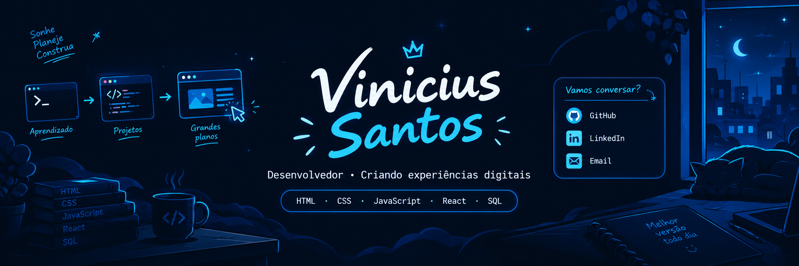
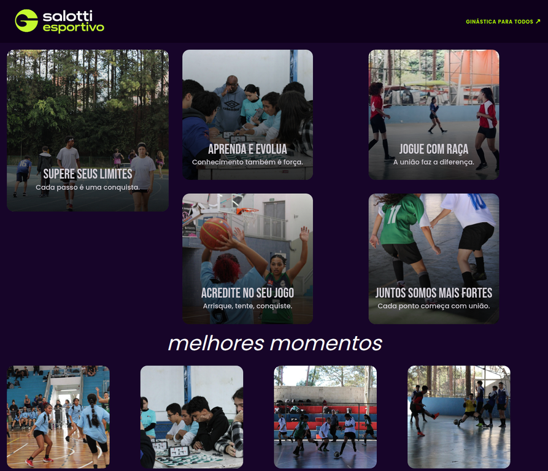
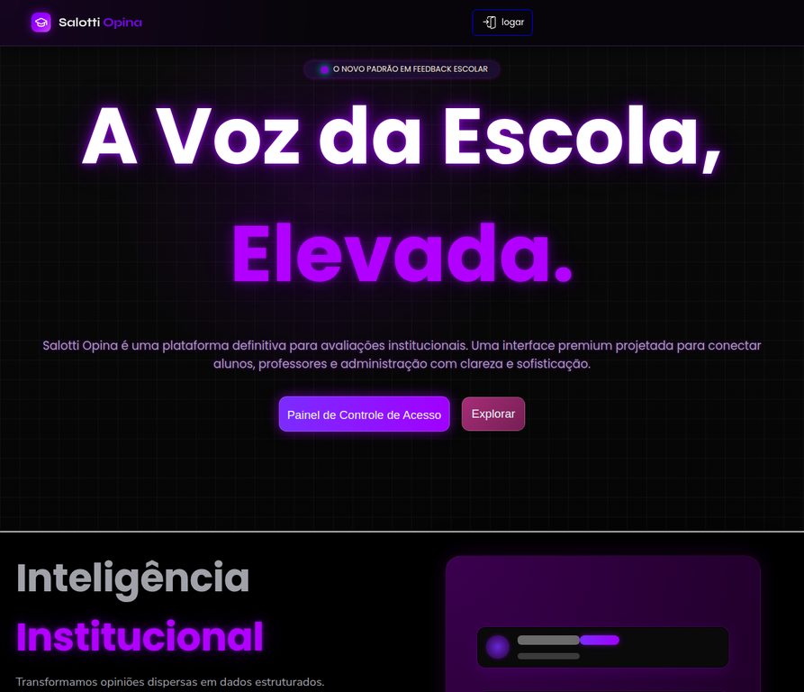
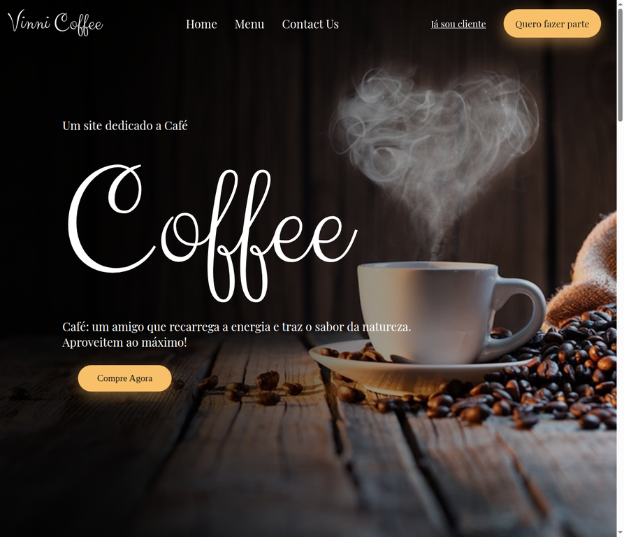

<div align="center">
  <a href="https://git.io/typing-svg">
  
</a>
</div>




<p align="center">Olá! Sou estudante do Ensino Médio técnico em Desenvolvimento de Sistemas. Meu objetivo principal é criar interfaces lindas, modernas e experiências digitais interativas das quais eu sinta orgulho de ter desenvolvido.

 **Meus Próximos Passos:**
* **Graduação:** Ingressar na faculdade de Análise e Desenvolvimento de Sistemas (ADS).
* **Carreira:** Conquistar o meu primeiro estágio na área de tecnologia.
* **Evolução:** Construir uma trajetória sólida e de constante aprendizado como desenvolvedor.

> *Transformando dedicação em código e ideias em interfaces únicas.*
  
#


<h3 align="left">Connect with me!</h3>

[](mailto:vini976964150@gmail.com)
[](https://www.linkedin.com/in/vin%C3%ADcius-santos-490922244/)
[](https://www.instagram.com/santoscamelovinicius/)


<h3 align="left">My Stack ~</h3>

<div align="left">

  
</div>

#

<div style="text-align: center;" align="center">
  <h3>* GitHub Stats *</h3>
  <br>
 <div align="center">
  <a href="https://git.io/streak-stats">
    
  </a>
</div>


 
#

<!-- SEÇÃO PREMIUM: SEU NOVO WIDGET ROXO TOTALMENTE INTEGRADO -->
<div align="center">
  <h3>🎵 Now Playing</h3>
  <br>
  <a href="https://youtu.be/ZLzDMCS6pPY?si=Mukm_pXg6pbyd0Qp" target="_blank">
    
  </a>
</div>

#

## Projetos

### Salotti Esportivo

Projeto web voltado à apresentação de modalidades esportivas e conteúdos relacionados ao esporte.



### Salotti Opina

Plataforma de avaliações e feedback escolar, conectando alunos, professores e administração.



### Vinni-Coffee

Projeto de interface para uma aplicação de cafeteria, desenvolvido com HTML, CSS e JavaScript.



#

<h3 align="left">📄 Meu Currículo</h3>

<a href="https://curriculo-terminal.onrender.com/">
  
</a>

**Também desenvolvi uma forma diferente de apresentar minha trajetória: um currículo que pode ser acessado diretamente pelo terminal.**

```bash
curl.exe https://curriculo-terminal.onrender.com/
```
